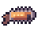
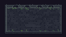
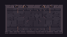

# Cinder Below game reference

This covers Cinder Below 1.2.2. It lists 24 weapons, 8 keepers, 14 boons, 11 relics, 10 regular enemies, 8 guardians, and 5 contracts. Guardian moves and final-stage details follow below.

Times assume 60 game steps per second. Combat pauses and hit stop can make elapsed time longer. Thumbnails come from the game atlases or reproduce its drawn icons. Relics and boons share the game's colored-diamond design.

## Weapons

Damage is the base amount per projectile, swing, or first hit. The weapon's effect can add hits or change damage. Energy is per trigger pull. Delay is in game steps before bonuses.

| Art | Weapon | Damage | Energy | Delay | Effect |
| --- | --- | --- | --- | --- | --- |
|  | Ember Pistol | 3 | 0 | 15 | Free single shot. Also fires as your fallback when you lack the energy for your selected weapon. |
|  | Keeper Blade | 5 | 0 | 21 | Short forward slash. Cuts hostile bullets in its arc. |
|  | Thorn Carbine | 3 | 1 | 8 | Fast single-shot carbine. |
|  | Hex Lantern | 6 | 2 | 17 | Piercing, slowing bolt. Can hit two enemies. |
|  | Cinder Buckshot | 3 × 5 | 3 | 24 | Wide five-pellet spread with ordinary projectile lifetime. |
|  | Frost Rail | 12 | 4 | 27 | Fast, heavy piercing shot. Can hit and slow two enemies. |
|  | Fire Moth | 8 | 4 | 24 | Slow shot that explodes on impact, damaging nearby enemies. |
|  | Bramble Scythe | 9 | 0 | 21 | Longer, stronger forward slash. Cuts hostile bullets in its arc. |
|  | Thunder Fork | 4 × 3 | 3 | 15 | Three piercing, slowing bolts in a spread. Each can hit two enemies. |
|  | Prism Repeater | 4 | 1 | 11 | Single shot that can bounce twice off walls or pillars. |
|  | Salt Cannon | 4 × 7 | 4 | 29 | Seven-pellet close-range spread. Pellets expire after 16 steps. |
|  | Storm Arc | 9 | 3 | 22 | Lightning jumps to up to four targets within line of sight. Each jump reduces damage by 2, to a minimum of 2. |
|  | Moon Disc | 5 | 2 | 35 | Returns after 21 steps or on impact with cover. It can hit the same enemy once on each leg. |
|  | Sawtooth | 7 | 0 | 31 | Full-circle melee sweep. Cuts hostile bullets around you. |
|  | Venom Flask | 3 | 2 | 25 | Lobs a flask that leaves a poison pool. The pool repeatedly damages and slows enemies. |
|  | Starshard | 7 | 3 | 19 | Fast shard that can pierce and hit up to five enemies. |
|  | Ashen Mortar | 12 | 4 | 34 | Short-range mortar that creates a delayed blast at impact or at the end of its flight. |
|  | Glass Needle | 3 × 2 | 1 | 9 | Fires two closely spaced piercing, slowing needles. |
|  | Echo Rifle | 6 | 3 | 23 | Fires the main shot immediately, then two angled follow-up shots from the same spot. |
|  | Floodgate | 4 × 3 | 3 | 23 | Fires three widely spaced shots. Each can bounce twice off walls or pillars. |
|  | Crown Chisel | 12 | 1 | 39 | Long melee swing that cuts bullets and sends a short-range projectile for 40% of the swing's damage, rounded up. |
|  | Wick Spire | 5 | 2 | 34 | Spawns a rotating spark around you for up to 109 steps. It can damage the same enemy again after its hit list resets. |
|  | Ash Beacon | 5 | 5 | 67 | Places an auto-firing turret for about 3.1 seconds. It targets the nearest enemy in sight within 120 pixels. |
|  | Wraith Lance | 8 | 3 | 23 | Piercing lance that passes through cover and can hit up to five enemies. |

## Keepers and skills

All keepers are selectable at the start. Each starts with 100 energy and two weapons. Pace is in pixels per game step. Cooldowns are base values.

| Art | Keeper | HP | Armor | Pace | Starting weapons | Skill and cooldown | Effect |
| --- | --- | --- | --- | --- | --- | --- | --- |
|  | Warden | 6 | 5 | 1.86 | Ember Pistol, Keeper Blade | Twin Flame · 7.00 s | For 4 seconds, adds a shot to ordinary ranged attacks, doubles melee damage, adds 4 damage to the first Storm Arc hit, or places a second Ash Beacon. |
|  | Outrider | 5 | 4 | 2.20 | Thorn Carbine, Ember Pistol | Phase Step · 2.37 s | Dashes for 12 steps, avoids damage, and deals 8 base damage once per enemy passed. |
|  | Hexsmith | 5 | 4 | 1.78 | Hex Lantern, Ember Pistol | Null Field · 5.33 s | Clears shots within 86 pixels and deals 10 base damage to nearby enemies. Slows those enemies for 2.5 seconds. |
|  | Alchemist | 5 | 4 | 1.94 | Venom Flask, Ember Pistol | Green Fire · 6.17 s | Throws two poison pools. Each repeatedly deals 4 base damage and slows enemies. |
|  | Sentinel | 7 | 5 | 1.62 | Sawtooth, Ember Pistol | Aegis · 6.50 s | Restores 1 armor and reflects shots in the direction you aim for 2.9 seconds. Reflected shots deal 3 damage. Movement slows by 12% while the shield is up. |
|  | Stargazer | 4 | 4 | 2.04 | Starshard, Keeper Blade | Starfall · 6.83 s | Marks up to five nearby enemies for 15-damage falling stars. If there are no targets, drops one star where you aim. |
|  | Tidecaller | 6 | 4 | 1.89 | Floodgate, Keeper Blade | Riptide · 6.50 s | An expanding wave clears shots, deals 7 base damage once per foe, slows it, and pushes regular enemies back. |
|  | Oathbreaker | 6 | 3 | 2.03 | Crown Chisel, Glass Needle | Blood Oath · 7.00 s | Spends 1 HP, down to a minimum of 1. For about 3.1 seconds, grants +23% movement speed and +35% weapon damage. A kill heals 1 HP when the run's kill count reaches a multiple of three. |

## Boons

Shrines offer up to two choices. Picking a boon you own adds one rank, up to its cap. A shrine pays 8 gold when its entire pool is maxed.

| Art | Boon | Max rank | Shrine | Effect |
| --- | --- | --- | --- | --- |
|  | Iron Bark | 3 | Ash | +2 maximum armor and refill it, each rank. |
|  | Bloodroot | 3 | Ash | +2 maximum HP and heal 3 HP, each rank. |
|  | Coal Heart | 3 | Ash | Multiply damage scaling by 1.25 per rank. This affects weapons and skills that use the damage stat. |
|  | Quicken | 3 | Ash and Sparks | Multiply attack rate and skill recharge rate by 1.20 per rank. This divides the delay and cooldown by 1.20, with rounding. |
|  | Deep Cell | 3 | Ash | +30 maximum energy and refill it, each rank. |
|  | Fleetfoot | 3 | Ash | Multiply movement speed by 1.15 per rank. |
|  | Warm Chamber | 1 | Ash and Sparks | Casting a skill makes the next attack free. |
|  | Edgeguard | 1 | Ash and Sparks | Recover 3 energy when a melee swing destroys at least one enemy shot. |
|  | Volley Rhythm | 1 | Ash and Sparks | Every sixth qualifying ranged attack fires two extra side shots at 61% damage, rounded up with a minimum of 2. |
|  | Cinder Focus | 2 | Ash and Sparks | Rank 1 lowers paid weapon attacks by 1 energy. Rank 2 lowers them by 2. Paid attacks cost at least 1. |
|  | Medic's Vow | 2 | Ash | Heal 1 HP every fourth combat clear at rank 1, or every third at rank 2. The counter includes earlier clears. |
|  | Smith's Favor | 2 | Ash and Sparks | Tempering costs 3 less gold at rank 1 and 6 less at rank 2. |
|  | Still Wick | 2 | Sparks | Reduce skill cooldown by 12% at rank 1 and 24% at rank 2. This stacks with Quicken. |
|  | Salvager | 2 | Sparks | Gain 2 gold per combat clear at rank 1 and 4 gold at rank 2. |

## Relics

A reliquary offers up to two choices from stage 2 onward. Each choice grants a new relic or increases its rank. A reliquary pays 8 gold if all relics are maxed.

| Art | Relic | Max rank | Effect |
| --- | --- | --- | --- |
|  | Breaker Shell | 2 | When armor drops to zero from a hit, clear hostile shots within 72 pixels at rank 1 or 104 at rank 2. |
|  | Mirror Iron | 2 | Ordinary pellets, piercing bolts, Starshard, and Echo Rifle shots gain one bounce at rank 1 or two at rank 2. They bounce off walls and pillars. |
|  | Ember Moth | 2 | Every fifth kill at rank 1, or fourth at rank 2, makes a delayed blast at the enemy's position. The blast starts at 9 damage and scales with your damage stat. |
|  | Soul Knot | 1 | Revive once per run at 3 HP with 4 seconds of invulnerability. Clears nearby hostile shots and shows REVIVED. |
|  | Harvest Lamp | 2 | Every third kill restores 10 energy at rank 1 or 16 at rank 2. |
|  | Low Light | 2 | +40% weapon damage at 2 HP or below at rank 1, or 3 HP or below at rank 2. |
|  | King's Ring | 2 | Deal +25% damage to guardians at rank 1 or +40% at rank 2. |
|  | Quick Heart | 2 | Each kill cuts the remaining skill cooldown by 0.20 seconds at rank 1 or 0.40 at rank 2. |
|  | Ember Canteen | 2 | Gain 6 extra energy per combat clear at rank 1 or 12 at rank 2. |
|  | Gateward Seal | 2 | Restore 1 armor on each combat clear at rank 1 or 2 at rank 2, including in Iron Trial and Endless Keep. |
|  | Guardian's Due | 2 | Each guardian drops 6 extra gold at rank 1 or 12 at rank 2. |

## Pickups, shop stock, and weapon tempering

Gold, energy, and hearts are proximity pickups. Weapons require interaction and replace the active slot. A swap leaves the old weapon and its temper on the floor.

| Art | Item or upgrade | Effect | Source |
| --- | --- | --- | --- |
|  | Gold | Pays for shop items and tempering. | Regular enemy 1–2 gold, elite 5, guardian 14 before Guardian's Due. Cache chest 3. Breakable props have a 1-in-3 chance to drop 1. |
|  | Energy pickup | Replenishes weapon energy by the amount on the pickup. | Enemy kill has a 1-in-4 chance to drop 9. Chest 20, gauntlet 25, guardian clear 35. |
|  | Heart | Heals 2 HP, up to max HP. | Guaranteed from gauntlets and guardian clears. Ordinary room clears have a 1-in-6 chance, rising to 7-in-12 at 2 HP or less. |
|  | Tonic | Heals 3 HP for 5 gold. | Tinker's Shop. Once per shop, only while below max HP. |
|  | Energy Cell | Restores 40 energy for 4 gold. | Tinker's Shop. Once per shop, only while below max energy. |
|  | Shop weapon | Buys one randomly stocked weapon and equips it in the active slot. Price = 10 + 3 × zero-based biome index + 2 × temper rank. | Tinker's Shop. The stock pool includes every weapon except Ember Pistol and Keeper Blade. |
|  | Temper +1 | +20% base weapon damage, rounded up after other attack multipliers. | Forge, or pre-tempered weapon loot starting at stage 4. |
|  | Temper +2 | +40% base weapon damage. | Forge, later loot and shops, or Arsenal Run at stages 7–8. |
|  | Temper +3 | +60% base weapon damage. This is the cap. | Forge or eligible late gear. |

Each forge tempers the active weapon once. The price is 9 gold + 7 × current temper + (stage − 1) − 3 × Smith's Favor rank. From stage 4 onward, a weapon dropped by a room, chest, or gauntlet starts at `clamp(floor((stage − 2) / 2), 1, 3)`, with a 1-in-3 chance of one rank less, down to +1. From stage 4, shop stock rolls from +1 to `clamp(floor((stage − 1) / 2), 1, 3)`.

## Rooms, encounters, and props

| Room or object | What it does |
| --- | --- |
| Landing | Safe entry room at the start of each stage. |
| Ambush | Mixes a pursuer and a ranged enemy with foes drawn from the biome's pool. The first fight in Root Gates guarantees at least two Skulks. |
| Crossfire | Sets up enemies along the left and right sides of the arena and adds one roaming enemy. If a spawn is blocked or too close to you, it falls back to a random position. |
| Elite Hunt | One wave with two guaranteed elites plus regular enemies. Clearing it guarantees a weapon drop. |
| Rupture | Alternates eruptions between two fixed vents. Has two clusters of pillars. |
| Swarm | One wave of the biome's designated rusher type, with two extra enemies. |
| Supply Cache | The chest offers a weapon you are not carrying, 20 energy, and 3 gold. Its weapon pool excludes the Ember Pistol and Keeper Blade. |
| Tinker's Shop | Sells a Tonic, an Energy Cell, and one weapon. Each purchase is available once per shop. |
| Shrine of Ash | Offers one boon or a rank upgrade. Every stage has one. On stages 1 and 2 in standard contracts, it prioritizes Iron Bark or Bloodroot until both are maxed. Ties favor Bloodroot if you are wounded. |
| Shrine of Sparks | Available from stage 2. Offers one spark boon or a rank upgrade. It prioritizes Still Wick or Quicken. |
| Reliquary | Available from stage 2. Offers one relic or a rank upgrade. |
| Temper Forge | Upgrades the weapon in the active slot once for gold. Every stage has one. |
| Salvage Rack | Pick one of two weapons. The selected weapon replaces your active weapon, which drops on the floor. |
| Keeper's Stores | Pick either 35 energy or 10 gold. |
| Temper Relay | Move one temper rank from the inactive weapon to the active weapon, or take 10 gold. |
| Gauntlet | Optional three-wave fight with floor hazards. Rewards one weapon from Bramble Scythe onward in the weapon table, a 2-HP heart, and 25 energy. |
| Elite Duel | A single elite rival attacks with less downtime. Winning earns a weapon from the gauntlet pool. Appears in place of the gauntlet on stages with Keeper's Stores. |
| Guardian room and portal | One guardian, two pillars, and a portal after all enemies are defeated. The portal advances the stage. The last portal ends a finite run or loops Endless Keep. |
| Pillar | Permanent cover. Blocks ordinary shots and movement. Compatible ricochet shots bounce off it. |
| Crate and small breakable prop | Blocks movement and shots until broken. Two points of durability. Each damaging hit removes at least one point, or one per four damage rounded down if greater. |

Fight doors stay locked until you clear every wave. Iron Trial and Endless Keep have 49 regular fights and 8 guardian rooms per circuit. In Main Delve, Arsenal Run, and Daily Contract, a safe stop replaces one fight per stage from stage 3, for 43 regular fights and 8 guardians. Each stage also has one optional gauntlet or duel.

## Stages and floor hazards

| Arena art | Stage | Biome | Required fights (standard / Iron or Endless) | Gauntlet hazard |
| --- | --- | --- | --- | --- |
|  | 1. Root Gates | Moss | 3 / 3 | Three offset bursts for 1 damage each. |
|  | 2. Mossvault | Moss | 4 / 4 | Same moss bursts. |
|  | 3. Emberworks | Cinder | 4 / 5 | Three blasts along a horizontal line in staggered order, 2 damage each. |
|  | 4. Cinder Halls | Cinder | 5 / 6 | Same staggered cinder blasts. |
|  | 5. Veil Tunnels | Veil | 6 / 7 | Three simultaneous blasts in a triangle, 2 damage each. |
|  | 6. The Hollow | Veil | 7 / 8 | Same triangular blasts. |
|  | 7. Glassfen | Glassfen | 7 / 8 | Three staggered blasts in a line across the direction from the arena center, 2 damage each. |
|  | 8. Black Reliquary | Black Reliquary | 7 / 8 | Four staggered blasts in a rotating cross, 2 damage each. |

Gauntlet hazards are centered near your projected position. Rupture vents stay in place and deal 1 damage. Guardians use their own hazard patterns.

## Regular enemies

Base HP is the value before stage, contract, cycle, and elite scaling. The names come from the game code.

| Art | Enemy | Base HP | Behavior |
| --- | --- | --- | --- |
|  | Skulk | 9 | Chases and lunges a short distance after a quick tell. |
|  | Spitter | 11 | Leads its aim and fires a spread of three shots in moss rooms or five later. Backs away up close. |
|  | Charger | 17 | Winds up a longer, targeted dash. |
|  | Wisp | 10 | Circles you and fires eight shots in a ring. |
|  | Sentry | 13 | Seeks line of sight, then fires three spaced shots along a fixed, leading aim. |
|  | Leech | 10 | Zigzags as it approaches, then lunges faster and farther than a Skulk. |
|  | Bruiser | 23 | Fires five large shots, sets a nearby floor blast, and deals 2 contact damage. |
|  | Harpoon | 15 | Creates distance, telegraphs a long aim line, and fires one fast shot. |
|  | Prism | 13 | Flanks you and fires five shots that can bounce off cover and walls. |
|  | Monk | 21 | Marks the floor under you and to one side, then detonates both spots in sequence. |
|  | Elite variant | ×2.25 HP | Gold-marked regular enemy with 9% faster movement and a larger collision radius. Drops 5 gold. |

| Biome | Standard spawn pool | Elite Hunt type | Swarm type |
| --- | --- | --- | --- |
| Moss | Skulk (double weight), Spitter, Charger, Sentry | Charger | Skulk |
| Cinder | Charger, Spitter, Bruiser, Sentry, Wisp | Bruiser | Charger |
| Veil | Wisp, Leech (double weight), Bruiser, Sentry | Leech | Leech |
| Glassfen | Harpoon (double weight), Prism, Wisp, Sentry | Harpoon | Prism |
| Black Reliquary | Monk (double weight), Prism, Bruiser, Harpoon | Monk | Bruiser |

## Guardians and abilities

HP below is for the first circuit of Main Delve, Arsenal Run, or Daily Contract. Iron Trial and Endless Keep apply the rules in the difficulty table.

| Art | Guardian | Stage | HP | Named moves and changes during the fight |
| --- | --- | --- | --- | --- |
|  | Mossjaw | 1 | 237 | **Moss Charge** dashes and ends in a bullet ring. **Thorn Fan** fires a spread. **Root Trap** marks three floor blasts. At 51% HP, the fan adds rear shots and **Root Ring** adds six eruptions around Mossjaw. |
|  | The Rootbound | 2 | 294 | **Seed Halo** fires a ring with a gap. **Thorn Salvo** fires two angled spreads. **Root Eruption** marks a trail of three blasts. Below 53% HP it summons one Skulk in standard contracts or two in Iron or Endless, and adds delayed rings. Iron and Endless also add four shots to attacks in this phase. |
|  | The Tin Ram | 3 | 349 | **Rivet Mines** marks a trail of four blasts. **Shrapnel Ring** fires a ring with a gap. **Tin Volley** fires two three-shot bursts in succession, with less time between them below 51% HP. |
|  | The Bell Forge | 4 | 588 | **Furnace Halo** fires a ring with a gap. **Coal Seams** marks four floor blasts. **Bellfire** fires two opposing spreads. Below 53% HP it summons two Sentries and adds delayed rings. |
|  | Veil Harrow | 5 | 461 | **Veil Step** tries to teleport past you and fires. **Prism Bounce** fires nine bouncing shots. **Veil Sigils** marks four blasts around you. At 51% HP, the blasts grow and attacks come faster. |
|  | The Pale Regent | 6 | 783 | **Pale Halo** fires a ring with a gap. **Regent's Step** tries to teleport to your flank and fires. **Hollow Sigil** combines bouncing shots with a targeted blast. Below 53% HP it summons two Leeches and adds aimed shots and delayed rings. |
|  | The Gilded Eel | 7 | 608 | **Glass Surge** dashes, leaves shots behind, and ends in a delayed blast. **Fen Quakes** marks four blasts. **Gilded Crossfire** fires opposing spreads. **Shatter Ring** fires a ring and a delayed second ring. At 48% HP it summons two Prisms. |
|  | Crown of Cinders | 8 | 783 | **Golden Rupture** marks three blasts initially and four in later phases. **Cinder Halo** fires two rings with gaps in sequence. **Royal Volley** fires opposing spreads. At 69% HP, it summons a Monk and adds **Crown Prism**, a sweep of bouncing shots. At 34%, it summons a Prism and adds **Sovereign Charge**, a dash that fires sideways and ends in a ring. |

## Contracts

| Contract | Rules |
| --- | --- |
| The Main Delve | Eight stages with standard armor repair, stage-transition healing, and control over your weapon pair. |
| Iron Trial | Starts at half the keeper's armor rounded up. Enemies have 13% more HP before rounding, move 13% faster, and tick down their attack cooldowns 17% faster. Armor repairs in cleared rooms only. No portal HP heal. |
| Arsenal Run | Uses standard recovery. Every combat clear, including guardians and gauntlets, gives two distinct random weapons and 17 extra energy. Both weapons are untempered on stages 1–3, +1 on 4–6, and +2 on 7–8. |
| Daily Contract | Uses standard recovery and a date-derived seed. Each stage reseeds with the date seed plus 8,731 per completed stage. Stores your best reached depth for the date. |
| Endless Keep | Unlocks after any finite win. The last portal restarts at stage 1 and advances the cycle. You keep your build. Later cycles raise enemy HP, add enemies and elites, and shorten hazard intervals. Armor repairs in cleared rooms only. |

The Keeper's Journal records discovered weapons and relics, runs started, deepest Main Delve stage, wins, and archived kills. Safe-room checkpoints save your build and room state. Reloading mid-fight returns you to the last checkpoint, while death or victory discards it. Boons, relics, and tempering belong to the run.

## Difficulty values

| What changes difficulty | Current value |
| --- | --- |
| Enemy HP by stage | Regular enemy HP = base HP + **2 × (stage − 1)**, then apply contract, cycle, and elite scaling and round up. Example for an unmodified Skulk at stage 2: 11 HP. |
| Guardian HP by stage | For stages 1–6, the pre-multiplier HP is `148 + 35 × (stage − 1)` on odd stages or `184 + 61 × (stage − 1)` on even stages. Stages 7 and 8 use 380 and 489. Multiply by 1.6, or 1.2 for the standard-contract Rootbound, then round up. Apply the remaining contract and cycle scaling afterward. |
| Iron and Endless HP scaling | Multiply by `1 + 0.12 × min(cycle, 7)`. Add 0.13 to the multiplier in Iron Trial. The first circuit is cycle 0. Endless HP scaling caps at +84%. The Rootbound has 392 HP in Endless cycle 0 and 443 HP in Iron Trial. |
| Count per ordinary wave | Base count = 4 + biome index (0–4, capped at 3) + 1 from wave 2 onward + a random 0 or 1 + up to 2 from the Endless cycle. Swarm adds 2. Elite Hunt instead starts with 2 elites and adds 2–4 more enemies depending on biome. |
| Endless elites | From cycle 1, the first eligible regular spawn in each wave is elite. From cycle 2, the first two are elite. Elite Hunt still spawns its two guaranteed elites. |
| Waves and time between fights | Most fights have 2 waves. The first Root Gates fight and every Elite Hunt or Swarm have 1. Gauntlets have 3. Regular rooms wait 48 steps before the first wave, then 50 between waves. Enemies emerge over 24 steps. |
| Hit damage | Most enemy shots and contact hits deal 1. Dashing enemies, guardians, and Bruisers can deal 2 on contact. Most floor blasts deal 2. Armor absorbs as much damage as it can and leftover damage reaches HP. |
| Hit protection | 32 steps after taking damage, about 0.53 seconds. Room entry grants at least 22 steps. Soul Knot grants 240 steps on revive. |
| Armor repair in combat | Main Delve, Arsenal, and Daily repair 1 point after 180 hit-free steps (3 seconds), then 1 per 300 steps (5 seconds). Taking damage resets the initial timer. Entering another uncleared room with missing armor restarts it. |
| Armor repair out of combat | All contracts shorten the timer to at most 86 steps after a clear, then recover 1 point every 53 steps until full. Gateward Seal can grant immediate armor on clear. |
| Between-room and portal recovery | Combat clears restore 11 energy. Each portal to another stage or circuit restores 30 energy and refills armor in every contract. It also heals 2 HP in every contract except Iron Trial. |
| Health and loot safety | At 2 HP or less, ordinary room clears increase the heart-drop chance to 7 in 12. The free Ember Pistol fires when the selected weapon would cost more energy than you have. |
| Periodic hazard cadence | Rupture first marks a vent after 108–143 steps, then alternates vents every 160 steps. Gauntlets first mark blasts after 145–212 steps, then trigger every 190 steps minus 11 per biome index (capped at three) and 6 per Endless cycle (capped at four). |
| Guardian timing | Intros last up to 90 steps and can be skipped once the guardian appears. In Iron and Endless, guardian cooldowns tick down 25% faster. Iron adds its own multiplier. The standard Rootbound's recovery is 47 steps before enrage and 42 afterward. Its enraged windup is 32 steps. |
| Regular-room pursuit | After the opening fight, regular-room foes begin with 12 fewer cooldown steps and take 24–30% less recovery time after attacking. Outside of dashes, pursuers move 22% faster and other foes 12% faster in those rooms. Duel rivals tick down cooldowns 55% faster. |
| Attack and movement penalties | A weapon's attack delay is its base delay divided by haste, rounded with a floor of 4 steps. Swapping slots imposes at least 6 steps before firing. Slowed enemies move at 53% of their normal pace. |
| Cover and room size | Combat takes place inside a 384 × 168 pixel rectangle. Cover layout is randomized from ten layouts for ordinary fights, with fixed pillar patterns for Elite Hunt, Rupture, and guardian rooms. |

Source files for the tables include [keeper and boon definitions](../objects/obj_keep/Create_0.gml), [weapons and combat](../scripts/lk_combat/lk_combat.gml), [room generation and loot](../scripts/lk_run/lk_run.gml), [relics and reward selection](../scripts/lk_relics/lk_relics.gml), [contracts and checkpoints](../scripts/lk_contracts/lk_contracts.gml), [guardian attacks and hazards](../scripts/lk_encounters/lk_encounters.gml), [champions and special projectiles](../scripts/lk_expansion/lk_expansion.gml), and [the Gilded Eel and late weapon behavior](../scripts/lk_late_combat/lk_late_combat.gml).
